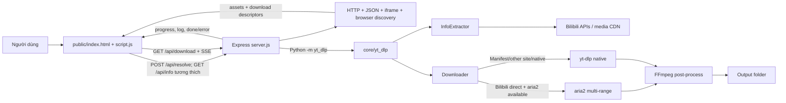

# Architecture

## Windows desktop — triển khai 2026-10-21

Người dùng đã duyệt phương án và yêu cầu triển khai cả bộ cài lẫn portable Windows x64. Đã tạo hai artifact phiên bản `0.3.0` bằng Electron `44.9.3` và electron-builder `26.15.3`; xem [[07 - Testing]] và `docs/WINDOWS_DESKTOP.md`.

- `desktop/main.js` mở cửa sổ với renderer sandbox/context isolation, không có Node integration. Backend Express chạy riêng bằng Node `24.22.0` tích hợp trong Electron, báo sẵn sàng qua IPC và dùng cổng loopback ngẫu nhiên. Cookie HttpOnly/SameSite ngẫu nhiên cùng kiểm tra Host/Origin hạn chế truy cập backend desktop; web mode hiện có giữ nguyên contract.
- Shell single-instance theo user-data; thoát sẽ kết thúc cây backend/Python/downloader/browser. Backend cũng theo dõi mất IPC với parent. Kiểm thử đóng app giữa một lượt tải đã xác nhận các PID con được dừng.
- `lib/runtime-paths.js` tách `EVERYVIDEO_RESOURCES_DIR`, `EVERYVIDEO_DATA_DIR`, `EVERYVIDEO_DOWNLOADS_DIR`. Desktop dùng thư mục app-data cho config/log/localStorage và Downloads/EveryVideo cho output mặc định; bản portable cũng giữ cấu hình trong app-data. Không có biến desktop thì `npm start` tiếp tục dùng đường dẫn dự án cũ.
- `electron-builder.cjs` chỉ đóng gói tài nguyên allowlist. Python embeddable, core vendored gồm cả JavaScript solver, FFmpeg/FFprobe, aria2, folder picker và Chromium headless của Playwright nằm ngoài ASAR. Không thay Chromium Playwright bằng Chromium của Electron. Bỏ `.links`, config/cookie/profile cá nhân, media, scratch/output và vault khỏi gói.
- Python dùng import path tương đối tới core; yt-dlp nhận rõ executable Node tích hợp cho JavaScript challenge. Helper và các tiến trình nền được ẩn console. Giữ nguyên frontend, API/SSE, DOM/i18n hook.
- Lệnh: `npm run desktop`, `desktop:check`, `desktop:pack`, `desktop:build`, `test:desktop`, `test:desktop-portable`. Giấy phép/notices đi kèm; không có tự cập nhật hoặc publishing tự động.
- Artifact: `dist/EveryVideo-0.3.0-Setup-x64.exe` (268.906.288 byte) và `dist/EveryVideo-0.3.0-Portable-x64.exe` (268.771.666 byte), mã kiểm tra ở `dist/SHA256SUMS.txt`. Cả hai chưa ký số nhà phát hành. Bản unpacked và portable thật đã được chạy trên host Windows với dữ liệu riêng và PATH chỉ có thư mục hệ thống; cài/gỡ cài trên VM Windows sạch chưa được kiểm chứng.
- Sau phản hồi mở chậm, người dùng xác nhận đang dùng portable EXE. Template NSIS `portable.nsi` xóa/giải nén gói vào temp mỗi lần chạy và xóa khi thoát; không chỉ ở lần mở đầu. Gói đầy đủ có 1.470 file, 898,3 MiB. Benchmark hai vòng trên host hiện tại: EXE tự giải nén 12.945/15.047 ms tới UI + config API sẵn sàng, bản thư mục 569/513 ms; phần lớn chênh lệch xuất hiện trước Chromium debug-ready. Không quy kết thêm cho antivirus khi chưa đo.
- Portable khuyến nghị hiện là `dist/EveryVideo-0.3.0-Portable-Folder-x64.zip` (366.093.029 byte): giải nén toàn bộ một lần rồi mở `EveryVideo.exe`, giữ các tài nguyên bên cạnh. ZIP đã giải nén vào `dist/EveryVideo-Portable-Folder/` để kiểm thử; executable/ASAR có hash giống bản unpacked và smoke đầy đủ pass. `desktop:build` thêm target ZIP; `desktop:zip` gói lại bản unpacked đã có; `desktop:benchmark` đo khởi động. Hai EXE trước đó được giữ nguyên.
- Cleanup cùng ngày: chỉ giữ bản giải nén `dist/win-unpacked/` làm đường dẫn app nhanh chuẩn trong workspace, bỏ bản giải nén ZIP trùng. Các package/checksum không đổi. Kế hoạch chuyển sang `docs/plans/`; hướng dẫn thư mục ở `docs/README.md`. Các evidence tạm được gọn lại trong `output/reports/windows-desktop-20261021/`; runtime cần thiết và lệnh build/test vẫn hoạt động.

Nguồn đối chiếu: [Electron introduction](https://www.electronjs.org/docs/latest/), [electron-builder Windows targets](https://www.electron.build/win/), [NSIS và portable](https://www.electron.build/nsis/).

## Khám phá media từ URL bất kỳ

Luồng Phân Tích hiện gửi `POST /api/resolve`: quét HTTP/HTML/JSON/iframe song song với hàm metadata yt-dlp dùng chung. Trang động chưa có nguồn phát được thử Chromium DOM/network; checkbox quét tương tác yêu cầu bước này luôn chạy. `/api/info` vẫn giữ contract cũ cho client hiện có.

`lib/media-network.js` chuẩn hóa HTTP(S), kiểm tra IP/DNS/redirect và pin các địa chỉ public đã xác minh. `lib/media-discovery.js` đọc tài sản HTML/JSON/Nuxt và formats/ảnh/phụ đề từ engine. `lib/media-browser.js` quản lý Chromium ẩn danh trong `.runtime/playwright`, chặn service worker/WebSocket, giới hạn request/byte/thời gian. `lib/media-resolver.js` hợp nhất URL nguyên query, phân bổ lượt xác minh giữa các loại và giữ descriptor trong RAM 15 phút.

`public/media-discovery.js` hiển thị nhiều nguồn, bộ lọc, sao chép URL và tải riêng. `lib/media-routes.js` cung cấp resolve, preview ảnh và tải SSE theo mã phiên/tài sản. File trực tiếp đi qua Node stream; manifests/fragments dùng `scripts/download-resolved-media.py` và FFmpeg trong thư mục staging riêng, sau đó chuyển file hoàn tất tới thư mục đã chọn. Cookie phiên quét chỉ nằm trong descriptor backend; không đưa vào payload assets hoặc clipboard. Preset/queue/tùy chọn chuyển đổi vẫn dùng downloader hiện có. Chi tiết và giới hạn: [[12 - Universal Media Extraction Implementation]].

## Cập nhật tiến độ tải

Backend giữ parser stream riêng cho stdout/stderr của tiến trình tải. Parser xử lý dữ liệu bị chia giữa các chunk và cả ký tự `\r` mà aria2 dùng để cập nhật cùng một dòng; tiến độ aria2 được chuyển thành SSE `progress` với phần trăm, dung lượng, tốc độ và ETA để frontend cập nhật thanh loading.

## Sơ đồ hệ thống

## Ranh giới trách nhiệm

### Frontend

`public/script.js` giữ state của URL hiện tại, browser cookie source, metadata, formats, subtitles, lựa chọn format, hàng chờ và EventSource đang chạy. Nó tạo query string cho backend và diễn giải log tải thành progress UI.

### Backend

`server.js` là lớp adapter giữa Web UI và engine:

- Đọc/lưu cấu hình runtime.
- Chuẩn hóa tham số UI thành CLI args của `yt_dlp`.
- Dùng `lib/download-acceleration.js` để chuẩn hóa engine/connections, resolve aria2 capability và chọn aria2 chỉ cho URL Bilibili direct; manifest vẫn native.
- Chọn resolver trực tiếp cho Douyin/TikTok hoặc fallback về engine chung.
- Quản lý child process/AbortController bằng `downloadId`.
- Chuyển stdout/stderr thành sự kiện SSE, gồm engine thực tế, fallback và CDN host đã che query.
- Cung cấp route phụ cho thumbnail, subtitle, dịch tiêu đề và folder picker.

### Python core

`core/yt_dlp` là một snapshot mã nguồn yt-dlp được vendored. Backend gọi bằng `python -u -m yt_dlp` với `PYTHONPATH=core`; vì vậy các thay đổi trong extractor cục bộ được dùng trực tiếp mà không cần cài package yt-dlp toàn hệ thống.

### FFmpeg

FFmpeg được dùng khi format video/audio tách rời cần mux, khi cắt đoạn, recode, đổi thumbnail hoặc nhúng metadata/phụ đề. Backend truyền `--ffmpeg-location` khi tìm thấy bản local; engine vẫn có thể tự tìm FFmpeg trong `PATH`.

## Luồng phân tích

1. Frontend gửi URL, nguồn cookie, tùy chọn Bilibili và browser mode tới `/api/resolve`.
2. Resolver chạy HTTP discovery và `yt_dlp -J`, mặc định `--no-playlist`, rồi browser khi cần.
3. Backend trả assets, trạng thái kiểm tra, mã phiên tạm và `info_dict` nếu engine có metadata.
4. Frontend hiển thị nguồn tải chung; nếu có metadata, tiếp tục chuẩn hóa formats cho preset/explorer/queue.

## Luồng tải

1. Frontend gửi format expression và tùy chọn tới `/api/download`.
2. Backend mở SSE, cấp `downloadId`, rồi spawn engine.
3. Với Bilibili, option builder chọn native hoặc aria2 multi-range cho HTTP(S) direct; mapping `dash,m3u8` luôn native.
4. Nếu Auto và aria2 lỗi ở external downloader, backend retry native đúng một lần bằng cùng output template.
5. Engine chọn format, tải fragment/file và gọi FFmpeg nếu cần; backend stream log/diagnostic để frontend cập nhật phần trăm, tốc độ, ETA và trạng thái.
6. Disconnect hoặc cancel sẽ cố dừng child process/AbortController và xóa task khỏi `activeDownloads`, không khởi động fallback sau cancel.

## Cấu hình và dữ liệu runtime

- `config.json` lưu cấu hình local và bị Git ignore.
- Frontend còn cache một số giá trị trong `localStorage`.
- `cookies.txt` là fallback nếu không chọn browser và file tồn tại; file này không được commit hay đưa vào vault.
- `Download/` là output mặc định; người dùng có thể chọn thư mục khác.
- Các file media lớn ở workspace là artifact runtime, không phải nguồn dự án.

## Phụ thuộc vận hành

- Node.js 22+ chạy server, Cheerio và Playwright.
- Python 3.9+ chạy core; thứ tự tìm là biến `EVERYVIDEO_PYTHON`, virtualenv local, rồi executable trong `PATH`.
- FFmpeg cần cho trải nghiệm tải video chất lượng cao đầy đủ.
- `aria2c` là tùy chọn; resolve từ `EVERYVIDEO_ARIA2C`, `bin/aria2c(.exe)` hoặc `PATH`. Thiếu aria2 không chặn native/Auto.
- Trình duyệt có thể cung cấp cookie cho nội dung yêu cầu đăng nhập.
- Chromium headless tùy chọn được cài cục bộ bằng `npm run setup:browser`; thiếu runtime vẫn có HTML/yt-dlp discovery.

## Chuẩn bị triển khai website — khảo sát 2026-10-08

Đây là đề xuất từ đọc mã, chưa triển khai hoặc kiểm chứng trên server Linux. Người dùng chưa chốt phạm vi cá nhân/nhóm/công khai hay nhà cung cấp hosting.

- Website cần môi trường chạy Express lâu dài và tạo được child process Python/FFmpeg; chỉ host thư mục `public/` không thực hiện được phân tích/tải. Frontend hiện tại có thể giữ nguyên framework.
- Hướng đề xuất ban đầu: một VPS Linux chạy Docker Compose, reverse proxy HTTPS và storage gắn ngoài container. Cài Node 22+, Python phù hợp core vendored, FFmpeg; aria2 và Chromium tùy nhu cầu. Không đóng gói binary Windows hoặc dữ liệu runtime cá nhân vào image. Chromium trên Linux cần cả system dependencies và đường dẫn browser thống nhất với `.runtime/playwright`; script hiện tại chỉ cài browser, chưa dùng `--with-deps`.
- Chức năng tải hiện ghi file trên máy chạy backend và báo hoàn tất qua SSE; chưa có endpoint trả file media hoàn tất về thiết bị người dùng. Bản web cần mã file/job và route tải file có kiểm tra quyền, cùng dọn file hết hạn/giới hạn dung lượng. Không mở công khai toàn bộ thư mục output.
- Folder picker, `powershell.exe` và Explorer là thao tác Windows trên máy backend; bản web cần bỏ/ẩn các thao tác này và dùng trải nghiệm tải file của trình duyệt. Không cho client chỉ định đường dẫn server tùy ý qua `output`, `output_template` hay `downloadFolder`.
- `--cookies-from-browser` đọc profile trên máy backend, không đọc trình duyệt của người đang truy cập website. Cần thiết kế riêng việc sử dụng nội dung có đăng nhập; không dùng chung cookie cá nhân cho khách truy cập.
- Hiện `config.json` dùng chung, `activeDownloads` và resolver descriptors ở RAM, API chưa có đăng nhập/quyền sở hữu job. Trước expose public cần authentication, isolation, quota/concurrency limit và hoàn tất audit fetch/proxy/engine tại [[06 - Known Issues and Risks]].
- SSE cần cấu hình proxy không buffer và timeout phù hợp. Tải hiện bị hủy khi kết nối đóng; nếu cần tiếp tục sau đóng tab/reconnect, phải tách worker/job khỏi SSE và lưu trạng thái bền vững. Chưa cần chọn Redis hay database cụ thể trước khi chốt phạm vi sử dụng.
- Gate trước phát hành: kiểm chứng Linux runtime, URL thực từ IP server đích, video/audio mux, tải file về client, hủy/reconnect, ownership, path confinement, quota và cleanup. Kết quả tải Bilibili trên máy local không bảo đảm tốc độ hoặc khả năng truy cập từ IP datacenter.

Nguồn vận hành đã đối chiếu: [Docker Compose production](https://docs.docker.com/compose/how-tos/production/), [Docker volumes](https://docs.docker.com/engine/storage/volumes/), [Playwright browsers/system dependencies](https://playwright.dev/docs/browsers), [Nginx proxy buffering/read timeout](https://nginx.org/en/docs/http/ngx_http_proxy_module.html).

### Lựa chọn Cloudflare — khảo sát cùng ngày

Người dùng hỏi thêm khả năng deploy Cloudflare; chưa yêu cầu tạo resource hoặc chốt phương án. Đã đối chiếu tài liệu hiện hành, chưa chạy ứng dụng trên Containers/Tunnel.

- `node:child_process` trên Workers chỉ là non-functional stub; `nodejs_compat` không làm `spawn`/`execFile` chạy Python hay FFmpeg native. Chỉ upload frontend lên Pages/Workers Static Assets chưa đủ để vận hành backend hiện tại.
- Hướng chạy toàn bộ trên Cloudflare: Workers Static Assets phục vụ `public/`, Worker định tuyến `/api/*` qua Durable Object tới Cloudflare Container chạy Express + Python vendored + FFmpeg (aria2/Chromium tùy nhu cầu), R2 giữ file hoàn tất. Containers hỗ trợ Linux runtime, yêu cầu image `linux/amd64` và Workers Paid. Durable Object là phần bắt buộc để truy cập/điều khiển container; có thể dùng persistent storage của nó cho trạng thái tác vụ ban đầu, chưa cần chọn thêm D1/Queues nếu chưa có yêu cầu.
- Cần Dockerfile Linux, kiểm chứng dependencies/process cancellation/Chromium, cấp Internet cho downloader và audit egress. Không copy binary Windows/config/cookie/media cá nhân vào image. API/session descriptor/job phải được định tuyến về đúng container hoặc lưu ngoài RAM; không copy mẫu random pool stateless vào resolver có session hiện tại.
- Disk container mặc định ephemeral và được tạo mới khi instance khởi động lại sau sleep. Tải/ghép trên scratch disk có quota, upload file hoàn tất sang R2 và trả route/link có quyền truy cập cho browser; không coi snapshot/FUSE là thay thế đơn giản cho thiết kế lưu video. Cần lưu trạng thái job bên ngoài container, xử lý sleep/restart/reconnect và dọn file hết hạn. Các khoảng trống web tại SEC-002 vẫn áp dụng.
- Giá đối chiếu ngày 2026-10-08: Workers Paid tối thiểu $5 USD/tháng/account với usage allowance; Containers phát sinh CPU, RAM, disk, network egress, Worker/Durable Object và log theo mức dùng. Không coi $5 là tổng chi phí cố định. R2 có storage/request billing và không tính egress trực tiếp; chính sách giá phải kiểm tra lại khi triển khai.
- Hướng ít thay đổi cho dùng cá nhân: Cloudflare Tunnel nối hostname tới Express trên máy local hoặc VPS, có Access bảo vệ. Backend vẫn chạy trên origin và origin phải online; file vẫn nằm trên origin nếu chưa thêm API tải file từ xa. Quick Tunnel `trycloudflare.com` không hỗ trợ SSE nên không phù hợp luồng download/progress hiện tại; dùng tunnel quản lý với hostname ổn định và kiểm chứng streaming.

Nguồn: [Workers Node compatibility](https://developers.cloudflare.com/workers/runtime-apis/nodejs/), [Static frontend/container backend](https://developers.cloudflare.com/containers/examples/container-backend/), [Containers lifecycle/runtime/storage](https://developers.cloudflare.com/containers/concepts/architecture/), [Containers pricing](https://developers.cloudflare.com/containers/platform/pricing/), [R2 pricing](https://developers.cloudflare.com/r2/pricing/), [Tunnel setup](https://developers.cloudflare.com/tunnel/get-started/), [Quick Tunnel limitations](https://developers.cloudflare.com/tunnel/get-started/quick-tunnels/).

### Ràng buộc miễn phí và độc lập máy cá nhân — làm rõ 2026-10-08

- Người dùng đã có tên miền quản lý trên Cloudflare, muốn phương án miễn phí và website vẫn chạy khi máy cá nhân tắt. Loại phương án Tunnel với origin trên máy cá nhân; chưa chốt nhà cung cấp backend hoặc phạm vi người dùng. Không tạo tài khoản, máy ảo, DNS hay deployment trong phiên khảo sát.
- Cloudflare Free không có Containers native. Hướng đề xuất đáp ứng kiến trúc hiện tại là máy ảo Oracle Cloud Always Free chạy toàn bộ Express/frontend/Python/FFmpeg, dùng Cloudflare cho DNS của tên miền. Có thể dùng tunnel quản lý với origin trên VM nếu cần Access; đây là origin trên cloud, không phải trên máy người dùng. Không bắt buộc tách frontend sang Workers hoặc thêm R2/D1 để bắt đầu.
- Tài liệu OCI kiểm tra ngày 2026-10-08 ghi A1 ARM tổng 2 OCPU/12 GB RAM (1.500 OCPU-hour/9.000 GB-hour mỗi tháng), 200 GB tổng boot/block volume và 10 TB outbound mỗi tháng. Không dùng mức 4 OCPU/24 GB từ các hướng dẫn cũ. Chọn image Ubuntu/Always Free trong home region, kiểm tra quota thực của tài khoản và giữ toàn bộ tài nguyên trong mức miễn phí; build dependencies/image ARM64 nếu chọn A1, khác yêu cầu AMD64 của Cloudflare Containers.
- Oracle yêu cầu thẻ tín dụng/ghi nợ phù hợp để xác minh, có thể giữ khoản authorization tạm rồi hoàn; tài khoản Free Tier tiếp tục Always Free sau trial nếu không nâng cấp. Không hứa nhận được VM: capacity khu vực có thể hết, VM nhàn rỗi có thể bị thu hồi và tài khoản bỏ không có thể bị ngừng. Tài liệu chính thức là điều kiện đánh giá, chưa có smoke từ IP Oracle hoặc provisioning thực.
- Phương án dễ thử hơn là Render Free Web Service Docker chạy toàn bộ app với tên miền Cloudflare trỏ về service. Chỉ xem là bản demo tải nhỏ: 0,1 CPU/512 MB, sleep sau 15 phút không có inbound request (wake khoảng một phút), disk tạm, quota giờ/bandwidth/build và có thể bị suspend do service-initiated internet traffic cao. Không coi đây là backend ổn định cho tải video lớn/thường xuyên; khi không có payment method, vượt quota dẫn tới ngừng dịch vụ thay vì billing.
- Trước mở website vẫn cần web mode (bỏ thao tác Windows, khóa output vào storage root, authentication/isolation, route trả file có quyền, giới hạn job/dung lượng/cleanup); kiểm chứng Linux/ARM, HLS/DASH mux và URL thật trên IP server. Nếu dùng DNS trực tiếp, HTTPS phải được cấu hình trên VM; tránh giả định Cloudflare cấp HTTPS cho origin chỉ nhờ quản lý DNS.

Nguồn: [OCI Always Free resources](https://docs.oracle.com/en-us/iaas/Content/FreeTier/freetier_topic-Always_Free_Resources.htm), [Oracle Free Tier/card verification](https://www.oracle.com/cloud/free/), [Render Free limits](https://render.com/docs/free), [Render compute plans](https://render.com/docs/compute-plans).
