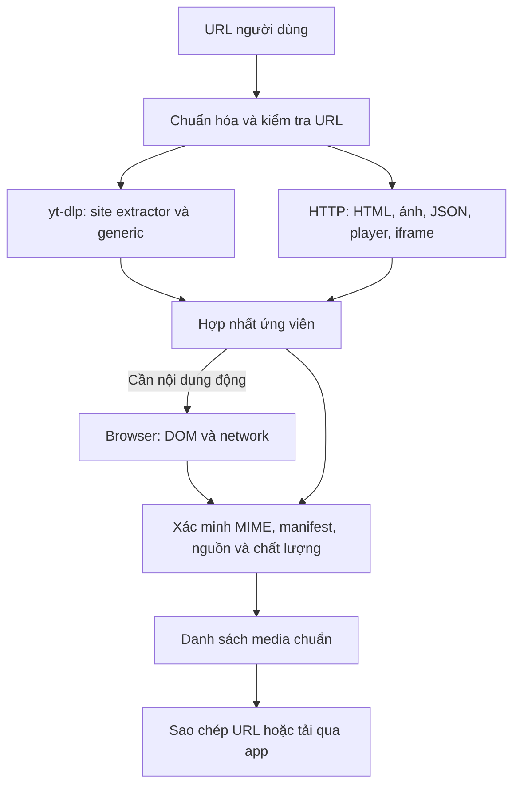

# Universal Media Extraction Research

> [!info] Tiến độ 2026-10-07
> Người dùng đã yêu cầu triển khai. Resolver chung HTTP + yt-dlp + Chromium, danh sách nhiều asset và tải qua descriptor đã hoạt động; kiểm thử fixture và nhiều URL public đã chạy. Báo cáo này giữ bối cảnh nghiên cứu ban đầu; trạng thái triển khai và giới hạn hiện tại nằm tại [[12 - Universal Media Extraction Implementation]].

## Kết luận

EveryVideo có thể phát triển thành công cụ dán URL để liệt kê audio, video, thumbnail và các nguồn tải mà trang cung cấp. Nền tảng hiện có phù hợp; không cần đổi framework hoặc thay downloader. Không thể bảo đảm 100% mọi URL: nội dung không tồn tại, yêu cầu quyền truy cập, DRM, anti-bot và thay đổi cấu trúc website vẫn là giới hạn.

Phạm vi do người dùng làm rõ: URL từ bất kỳ website nào; NhacCuaTui chỉ là ví dụ kiểm chứng. Ưu tiên xây bộ khám phá media tổng quát, không lấy việc thêm extractor cho một domain làm mục tiêu MVP. Các nhận xét chưa triển khai bên dưới mô tả thời điểm nghiên cứu ban đầu.

## Yêu cầu sản phẩm và khoảng trống hiện tại

- Nhận URL mà hệ thống chưa biết domain; hỗ trợ trang HTML, trang chạy JavaScript, player nhúng và URL media trực tiếp.
- Liệt kê nhiều audio/video/ảnh/thumbnail trong trang cùng các chất lượng tìm được. Media từ CDN hoặc iframe vẫn thuộc phạm vi trang; không tự crawl toàn bộ website.
- Hiển thị nguồn đã xác minh và ứng viên chưa xác minh, cho sao chép URL hoặc tải qua app. Trả một phần kết quả nếu lấy được ảnh nhưng audio/video chưa khả dụng.
- Không yêu cầu viết parser riêng cho từng website trước khi có thể tìm media. Adapter theo domain là phần tăng độ chính xác/khả năng hỗ trợ cho trường hợp đặc biệt.

Rà soát core cho thấy GenericIE đã hỗ trợ direct media bằng MIME, HLS/DASH, embed, cấu hình JWPlayer/Video.js, JSON-LD và một số mẫu Open Graph. Nó trả kết quả theo nhóm nhận diện trước; một số đường lọc loại image/subtitle khỏi video candidates. Vì vậy đây chưa phải bộ liệt kê toàn bộ tài sản media của trang. Với trang chỉ có ảnh hoặc metadata, GenericIE có thể ném UnsupportedError dù vẫn có tài sản hữu ích.

Backend hiện chạy yt-dlp để phân tích; tham số `browser` chỉ dùng lấy cookie từ trình duyệt. `package.json` chưa có Playwright/Puppeteer và chưa thấy pipeline điều khiển trình duyệt để thu DOM/network. Không được diễn giải cookie support thành browser media discovery đã có.

## Khả năng tái sử dụng dự án

- `server.js` `/api/info` đã gọi `yt_dlp -J` và trả info dictionary, có `formats[].url`, `http_headers`, `thumbnail` khi extractor cung cấp.
- `public/script.js` giữ format gốc ở `parsedFormats[].raw`; có thể lấy `raw.url` cho thao tác sao chép nguồn. Hiện chưa có nút sao chép URL media.
- UI đã nhận diện audio-only qua `vcodec=none`, hiển thị bitrate và có tải thumbnail.
- `/api/download` phân tích lại URL nguồn khi tải, phù hợp việc lấy URL mới. Chưa có cơ chế refresh/retry giữa một lần tải khi token hết hạn.
- Direct thumbnail saver hiện ghi byte vào tên `_thumb.jpg` mà không chuyển định dạng. Mẫu NhacCuaTui trả WebP: cần chọn đuôi theo MIME/byte signature hoặc thực sự chuyển sang JPEG.

## Kiến trúc mở rộng đề xuất

Xây resolver chung cho page assets; tái sử dụng info dictionary của yt-dlp cho audio/video/formats. Hai nguồn HTTP discovery và yt-dlp bổ sung cho nhau, không dừng quét ảnh/media khác chỉ vì đã tìm được một video:

HTTP discovery đọc `<audio>`, `<video>`, `<source>`, ``, `srcset`, `<picture>`, `poster`, CSS image URL, JSON-LD, Open Graph, JSON hydration và cấu hình player. Resolve relative URL theo base URL, theo iframe có giới hạn, không thực thi tùy ý script tải về. Open Graph có thể chỉ cung cấp metadata/ảnh.

Browser discovery gắn listener trước navigation, đọc DOM sau render (`currentSrc`, ảnh lazy load, CSS background) và theo dõi request/response từ player/XHR/fetch. Playwright có API network events phù hợp; đây là năng lực API đã xác minh bằng tài liệu, chưa có browser prototype chạy trên dự án. Player có thể cần play hoặc cuộn trang; worker cần chính sách tương tác có giới hạn, không click tùy ý nút tạo giao dịch hoặc thay đổi dữ liệu.

Nhận dạng theo Content-Type và nội dung/manifest, không chỉ đuôi `.mp3`/`.mp4`: URL có thể không có extension. `blob:` của MediaSource không phải URL file nguồn; cần tìm manifest/fragment request bên dưới. Service worker có thể ảnh hưởng visibility của network và phải có test riêng. DASH/HLS phải nhóm fragment theo manifest/track thay vì hiển thị hàng trăm segment như file riêng.

Hợp nhất và chống trùng có provenance: method (extractor/html/json/dom/network), source page/frame, media type, chất lượng, URL gốc, MIME và trạng thái xác minh. Giữ nguyên query ký số khi tải; không xóa query để chống trùng. Với trang nhiều bài/video/ảnh, giữ các tài sản riêng và ghi quan hệ khi có bằng chứng, không chọn tất cả URL thành một bài. Dùng provenance để giúp nhận diện quảng cáo/tracking; bộ lọc không được âm thầm loại nội dung chưa xác định.

Đề xuất thêm `POST /api/resolve` cho danh sách `assets[]`, trong khi giữ contract `/api/info` hiện có. Asset chứa ID, loại, URL, metadata, formats/manifest nếu có, header công khai và download descriptor. Descriptor phải được quản lý cùng session/backend để `/api/download` có thể tải direct/manifest được discovery tìm ra, kể cả khi URL trang gốc unsupported. Cookie vẫn quản lý phía backend. Contract cụ thể cần chốt khi triển khai.

Phải giới hạn thời gian, số request, dung lượng đọc, redirect và số iframe. Lỗi đăng nhập/quyền truy cập/DRM đã xác định cần trả trạng thái tương ứng, không lặp vô hạn qua mọi fallback. Browser fallback chậm và nặng hơn HTTP, chỉ bổ sung sau khi có mẫu chứng minh nhu cầu.

Đề xuất kết quả hiển thị:

| Loại nguồn | Ý nghĩa của URL | Hành động |
| --- | --- | --- |
| Direct MP3/MP4/image | URL file, có thể cần header/session | Sao chép URL, mở nguồn, tải qua app |
| HLS/DASH | Manifest hoặc tập fragment, có thể tách audio/video | Sao chép URL manifest; app tải và ghép bằng yt-dlp/FFmpeg |
| Stream video-only/audio-only | Một thành phần của sản phẩm cuối | Ghi rõ loại stream; cho chọn ghép khi tải |
| Metadata-only | Có tên/ảnh nhưng chưa có media khả dụng | Hiển thị phần đã lấy được và lý do thiếu audio/video |

Không hứa URL nào cũng mở trực tiếp được trong trình duyệt. Giữ header công khai cần thiết như Referer/User-Agent; thông tin xác thực tiếp tục quản lý trong session backend, không đưa cookie vào chức năng sao chép. Không log/lưu lâu dài URL có token. Unknown expiry phải để chưa rõ, không đoán từ tên tham số.

## Trade-off và quyết định đề xuất

| Phương án | Lợi ích | Đánh đổi |
| --- | --- | --- |
| Resolver chung: HTTP discovery + yt-dlp + browser có điều kiện | Hoạt động theo cơ chế web chung, tận dụng formats/downloader đã có | Cần xử lý asset schema, false positive, browser runtime và refresh URL |
| Tự viết engine quét URL hoàn toàn | Kiểm soát pipeline | Lặp lại nhiều khả năng yt-dlp, dễ lấy nhầm media, chi phí lớn |
| Luôn mở browser cho mọi link | Quan sát được player chạy JavaScript | Tốn tài nguyên, chậm; vẫn không bảo đảm DRM/quyền truy cập |

Đề xuất chọn resolver chung ở phương án đầu. Browser discovery là thành phần trong thiết kế tổng quát cho website động, chạy khi cần để giới hạn chi phí. Adapter theo domain bổ sung sau theo mẫu lỗi thực tế. Đây là đề xuất, chưa phải quyết định triển khai đã được duyệt.

## Thứ tự triển khai

1. **Resolver tổng quát và HTTP discovery:** normalize URL, detect direct response, quét HTML/ảnh/JSON/embed, kết hợp yt-dlp, schema `assets[]`, xác minh nguồn và partial results.
2. **Browser discovery:** DOM sau render + network capture, player/iframe/lazy-load có giới hạn, nhận manifest/MIME không extension, timeout và provenance.
3. **Trải nghiệm nguồn tải:** liệt kê nhiều media, sao chép URL, chọn chất lượng, tải qua descriptor; xử lý refresh URL, direct/manifest và MIME đúng của thumbnail; giữ contract/i18n hiện hành.
4. **Mở rộng độ phủ:** benchmark theo loại cơ chế web và nhiều domain chưa khai báo; thêm adapter đặc thù khi có bằng chứng generic/browser chưa đủ. NhacCuaTui là một test case trong ma trận.

Gate tổng quát: ma trận direct audio/video/image, HTML5 source, image-only/srcset, embedded player khác domain, JSON hydration, JavaScript/fetch, lazy-load, HLS/DASH, nhiều asset, URL không extension, signed URL, session-required và no-media. Đo số asset có thể tải được, false positive, tỷ lệ resolve thành công và độ trễ theo nhóm. Domain dùng để kiểm chứng rộng, không dùng làm allowlist nhận diện. Chưa chạy ma trận này; bằng chứng mạng hiện tại chỉ là case minh họa phía dưới.

Fixtures không chứa token; offline integration dùng server fixture và asset do dự án tạo; live tests opt-in với nguồn public. Verification cần kiểm tra MIME/byte signature và FFprobe khi đã tải media hoàn chỉnh. Giữ regression Bilibili/TikTok/Douyin và custom Bilibili patch. Trạng thái not-found/access-denied/no-media/DRM cần rõ ràng, không đoán từ lỗi generic.

Kiểm tra protocol/host/DNS/redirect khi fetch URL tùy ý liên quan trực tiếp [[06 - Known Issues and Risks#SEC-001 — Các route fetch remote cần xem xét SSRF]]. Ưu tiên localhost; browser fallback phải có cùng giới hạn đích truy cập với HTTP fetch.

## Phụ lục: case minh họa NhacCuaTui ngày 2026-10-07

URL mẫu: `https://www.nhaccuatui.com/song/z83dVcWCwQmo`.

| Thuộc tính | Kết quả |
| --- | --- |
| Bài hát | Lưu Niên |
| Nghệ sĩ | Jack - J97 |
| Thời lượng metadata | 194 giây |
| Core dự án | yt-dlp 2026.07.04, 1.751 extractor classes; số class không tương đương số website |
| Extractor khớp URL hiện tại | Chỉ `generic` |
| Kết quả trích xuất nguyên bản | `Unsupported URL` sau khi đọc được trang |
| HTML công khai | HTTP 200, có `__NUXT_DATA__` |
| MP3 128 kbps | Stream và download URL đều HTTP 206; `audio/mpeg`; tổng dung lượng 3.352.331 bytes |
| MP3 320 kbps | Stream và download URL đều HTTP 206; `audio/mpeg`; tổng dung lượng 8.018.009 bytes |
| Kiểm tra khung MP3 | MPEG-1 Layer III, lần lượt 128/320 kbps, sample rate 44.100 Hz |
| Thumbnail | HTTP 200; `image/webp`, 6.310 bytes, dù URL có đuôi `.jpg` |
| Lossless | Có record nhưng `onlyVIP=true`, `status=0`; không request hoặc liệt kê như format khả dụng |
| Chuẩn hóa bằng core | `_search_nuxt_json` và `YoutubeDL.process_ie_result(download=False)` pass; chọn format `320` |

Chỉ đọc các phần nhỏ của audio bằng HTTP Range; chưa tải toàn bài, chưa thử qua API/UI hoặc FFprobe end-to-end. Thời lượng lấy từ metadata. Các HTTP request dùng User-Agent và Referer công khai; chưa kiểm chứng header nào là bắt buộc. Thử trong sandbox ban đầu gặp lỗi DNS; kiểm chứng mạng thật sau đó thành công.

Văn bản trang được công cụ web đọc có thông báo tạm không phát được bài, nhưng URL stream công khai thực tế trả MP3 hợp lệ. Không dùng riêng thông báo UI/HTML để kết luận media không tồn tại.

Không lưu HTML gốc, lời bài hát, URL audio có query ký số, cookie hoặc thông tin tài khoản vào vault. URL ảnh không có query: [Ảnh bìa bài mẫu](https://image-cdn.nct.vn/song/2026/08/24/n/7/q/b/1787555472832_300.jpg).

### Chi tiết case minh họa

1. Chuẩn hóa URL; thêm `https://` khi người dùng dán hostname/path như ví dụ.
2. Tải HTML trang bài hát và dùng `InfoExtractor._search_nuxt_json` để giải mã graph tham chiếu Nuxt/devalue. Helper này đã có trong `core/yt_dlp/extractor/common.py`.
3. Tìm record có `key` đúng song ID và có `streamURL`; không quét regex lấy tất cả `.mp3`. Trang mẫu chứa cả URL của bài được gợi ý, nên quét toàn trang dễ lấy sai bài.
4. Đọc `name`, `artistName`, `duration`, `image`; mỗi phần tử `streamURL` có `type`, `typeUI`, `stream`, `download`, `status`, `onlyVIP`.
5. Với mẫu hiện tại, hai record public có `status=1`, `onlyVIP=false`; tạo format MP3 `vcodec=none`, `acodec=mp3`, `abr=128/320`, `format_id=128/320`. Ngữ nghĩa các trạng thái khác cần thêm mẫu trước khi tổng quát hóa.
6. Giữ nguyên URL/query do trang trả về; không tự tạo chữ ký hoặc đổi CDN. URL có tham số ký số nên cần xử lý như nguồn tạm thời và resolve lại khi cần; thời hạn cụ thể chưa được xác minh.

Với riêng minh họa này, extractor trong core có thể tăng độ chính xác và dùng chung cho analyze/download. Đây là một adapter bổ sung, không phải trọng tâm MVP. Bộ khám phá tổng quát cũng cần đọc JSON nhúng và graph tham chiếu như Nuxt; dữ liệu có cấu trúc vẫn phải kiểm tra URL thực tế. Thêm resolver chỉ ở `/api/info` sẽ khiến bước tải thất bại nếu tiếp tục gửi URL trang mà Python chưa hỗ trợ, nên cần download descriptor chung.

## Nguồn

- [Trang bài mẫu NhacCuaTui](https://www.nhaccuatui.com/song/z83dVcWCwQmo): HTML/SSR và các URL media public được kiểm tra trực tiếp ngày 2026-10-07.
- [Danh sách supported sites của yt-dlp](https://github.com/yt-dlp/yt-dlp/blob/master/supportedsites.md): generic/embed có thể hỗ trợ ngoài danh sách; website có tên trong danh sách vẫn có thể hỏng. Không tìm thấy mục NhacCuaTui trong danh sách đã đọc.
- [FAQ chính thức về xác định URL được hỗ trợ](https://github.com/yt-dlp/yt-dlp-wiki/blob/master/FAQ.md): chỉ match GenericIE không chứng minh trích xuất thành công; phải thử URL thực tế.
- [InfoExtractor contract và Nuxt helpers](https://github.com/yt-dlp/yt-dlp/blob/master/yt_dlp/extractor/common.py): formats, direct/manifest URL, http_headers, thumbnails, has_drm. Helper Nuxt cũng được đọc và chạy thành công trong core cục bộ.
- [GenericIE upstream](https://github.com/yt-dlp/yt-dlp/blob/master/yt_dlp/extractor/generic.py): đối chiếu generic source với core cục bộ để xác định khả năng và khoảng trống asset discovery.
- [Playwright network](https://playwright.dev/docs/network): quan sát request/response, và giới hạn liên quan service worker; chưa kiểm chứng browser worker của dự án.
- [MediaSource](https://developer.mozilla.org/en-US/docs/Web/API/MediaSource): object URL có thể tham chiếu MediaSource nhận byte qua request riêng, không tương đương direct media URL.
